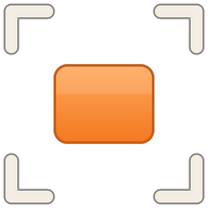
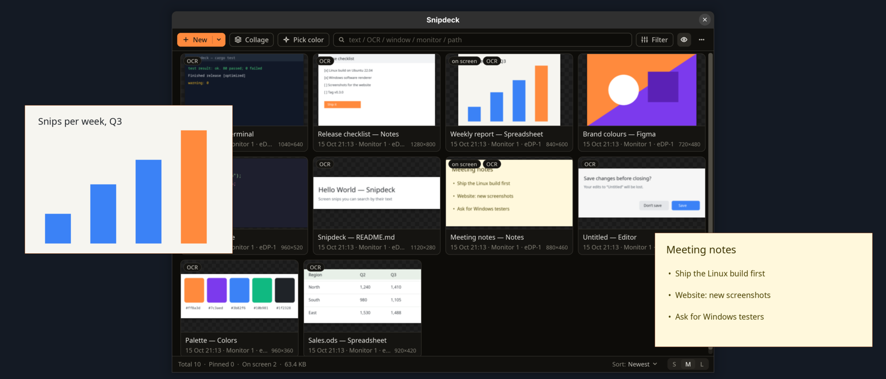
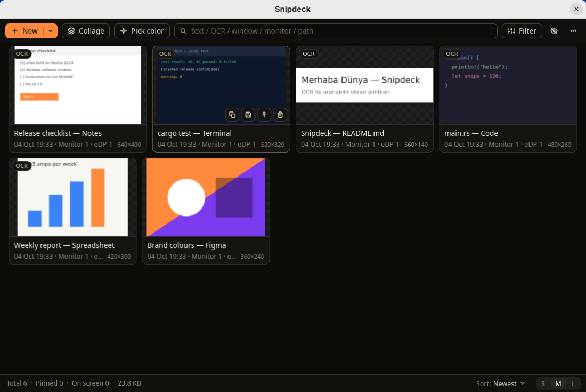
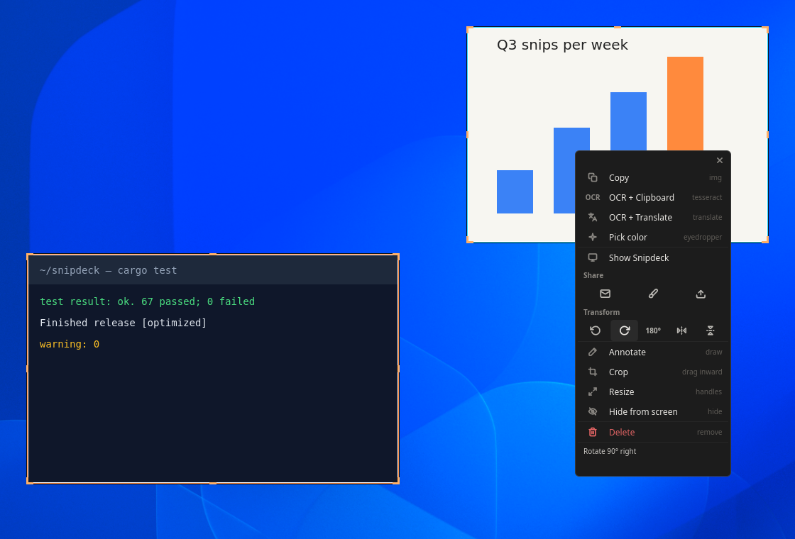
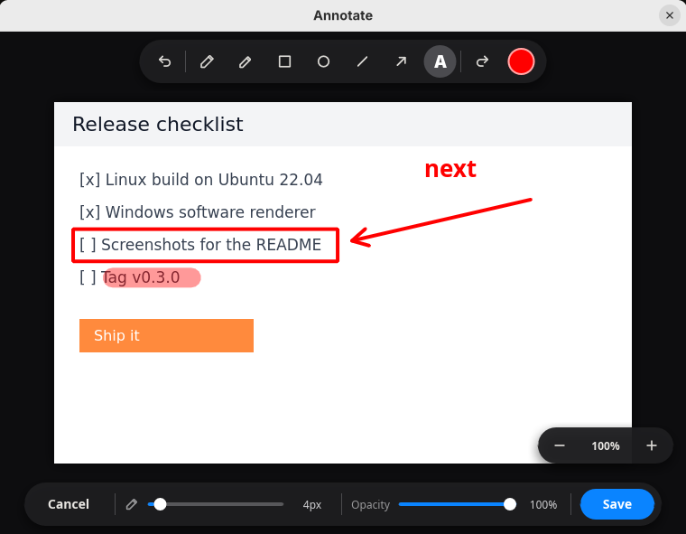
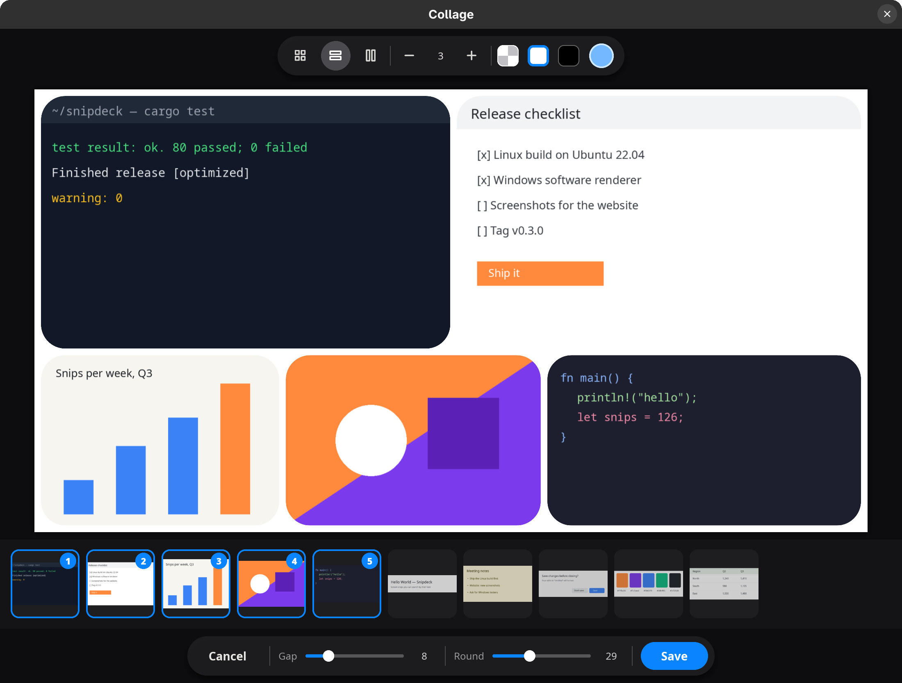

<div align="center">

[English](README.md) · [Türkçe](README.tr.md) · [Español](README.es.md) · [简体中文](README.zh-CN.md) · [العربية](README.ar.md) · [Русский](README.ru.md) · [Deutsch](README.de.md) · [日本語](README.ja.md) · **Français** · [Português](README.pt.md)

</div>

<div align="center">



# Snipdeck

**Un _deck_ de capture d'écran rapide et piloté au clavier pour Windows et Linux.**

<sub>Une application gratuite et open source de <a href="https://revisetouch.com"><b>ReviseTouch</b></a>.</sub>

Capturez une zone, gardez vos captures flottantes au-dessus de tout, annotez-les,
indexez-les par OCR et recherchez parmi des centaines de captures d'écran depuis une seule galerie dense —
le tout depuis une application Rust native dotée d'une interface [Slint](https://slint.dev).

 
 


<br/>
<picture>
  <source media="(prefers-color-scheme: light)" srcset="docs/screenshots/hero-en-light.png">
  
</picture>

</div>

---

## 📸 Captures d'écran

<!--
  Drop your screenshots into docs/screenshots/ with these exact names and they
  will show up here automatically:
    gallery.png · floating.png · annotate.png · collage.png
-->

<div align="center">

| L'espace de travail de la galerie | Captures flottantes sur le bureau |
| :---: | :---: |
|  |  |
| **L'éditeur d'annotation** | **L'éditeur de collage** |
|  |  |

</div>

---

## ✨ Points forts

- 🖱️ **Capture sur modificateur + glisser.** Maintenez `Win` et faites glisser une zone ; les modificateurs décident de ce qui
  arrive au résultat — fenêtre flottante, presse-papiers, galerie uniquement ([matrice ci-dessous](#️-raccourcis-de-capture)).
- 🧊 **Capture par gel d'abord** (`Win`+`Shift`+`Space`). Assombrit et gèle l'écran *avant* votre
  sélection, afin que les info-bulles au survol et autres éléments d'interface sensibles au clic restent capturés.
- 📌 **Captures flottantes.** Les captures restent épinglées au-dessus sous forme de superpositions légères et sans bordure que vous pouvez
  déplacer, redimensionner, épingler, rogner, faire pivoter/retourner et fermer.
- ✏️ **Éditeur d'annotation intégré.** Stylo, surligneur, formes, flèches et texte avec une roue chromatique TSV
  complète, taille et opacité réglables, zoom, et annuler/rétablir ([détails](#️-éditeur-dannotation)).
- 🧩 **Collage.** Disposez plusieurs captures en une seule image — grille, rangées justifiées ou mosaïque (masonry),
  avec espacement, coins arrondis et arrière-plan — enregistrée dans la galerie comme une nouvelle capture.
- 🔍 **OCR intégré.** Chaque capture est indexée par OCR en arrière-plan grâce au moteur du système d'exploitation
  (`Windows.Media.Ocr`) — aucun téléchargement de modèle, aucun réseau, entièrement local.
- 🌐 **OCR + traduction.** Lisez le texte d'une capture dans une autre langue directement sur place (29 cibles, avec
  des favoris que vous pouvez marquer d'une étoile).
- 🗂️ **Galerie puissante.** Recherche en texte intégral sur le texte OCR, les métadonnées de fenêtre, le moniteur et le chemin ;
  filtrage par statut / contenu / taille / date ; une grille virtualisée qui reste fluide même avec des milliers de captures
  ([visite guidée](#️-la-galerie)).
- 📤 **Partage et envoi.** Volet de partage Windows, un nouvel e-mail (Simple MAPI), l'éditeur d'images du système,
  ou un hébergeur d'images — catbox.moe, Imgur ou **votre propre serveur** à partir d'un fichier ShareX `.sxcu`
  ([détails](#-votre-propre-hébergeur-dimages)). Chaque envoi **demande d'abord**.
- 🌍 **23 langues**, détectées automatiquement depuis votre système d'exploitation et commutables depuis le menu `⋯` de la barre d'outils.
- 🌗 **Thèmes clair / sombre**, un accueil dans la zone de notification, et un lancement au démarrage **sans registre**.

---

## ⌨️ Raccourcis de capture

Maintenez `Win`, puis faites glisser une zone avec le bouton **gauche** de la souris. Ajoutez des modificateurs pour changer ce qui
arrive à la capture :

| Raccourci | Résultat |
| --- | --- |
| `Win` + glisser | Capture flottante à l'écran |
| `Win`+`Ctrl` + glisser | Capture flottante **et** copie dans le presse-papiers |
| `Win`+`Alt` + glisser | Presse-papiers uniquement (non ajoutée à la galerie) |
| `Win`+`Shift` + glisser | Galerie uniquement (pas de fenêtre flottante) |
| `Win`+`Ctrl`+`Shift` + glisser | Galerie **et** presse-papiers, pas de fenêtre flottante |
| `Win`+`Shift`+`Space`, puis glisser | **Gel d'abord** — gèle l'écran, puis sélectionnez sur l'image figée |

Vous pouvez aussi faire un clic droit sur l'icône de la zone de notification → **Nouvelle capture** pour armer une capture par glisser unique sans
maintenir `Win`.

### Raccourcis clavier globaux

Outre `Win` + glisser, Snipdeck enregistre cinq raccourcis clavier globaux configurables :

| Raccourci | Action |
| --- | --- |
| `Win`+`Alt`+`H` | Afficher / masquer toutes les captures à l'écran |
| `Ctrl`+`Alt`+`Shift`+`A` | Nouvelle capture |
| `Ctrl`+`Alt`+`Shift`+`C` | Nouvelle capture **et** copie dans le presse-papiers |
| `Ctrl`+`Alt`+`Shift`+`X` | Presse-papiers uniquement |
| `Ctrl`+`Alt`+`Shift`+`G` | Ouvrir la galerie |

Modifiez-les avec les clés `hotkey_*` dans `settings.json`. Sous Wayland, les raccourcis
globaux appartiennent au bureau : ils ne sont que proposés au premier lancement, et vous les
modifiez ensuite dans les paramètres clavier de votre bureau.

---

## ✏️ Éditeur d'annotation

Faites un clic droit sur n'importe quelle capture → **Annoter** pour ouvrir un éditeur ciblé, façon Telegram, qui se place au-dessus
de vos captures.

- **Outils** — stylo à main levée, surligneur, rectangle, ellipse, ligne, flèche et texte.
- **Roue chromatique TSV complète** avec un curseur de luminosité — choisissez *n'importe quelle* couleur, pas une palette figée.
- **Curseurs de taille et d'opacité** avec un aperçu de taille clignotant sur l'image, mémorisé par outil.
- **Zoom avant / arrière / ajuster** pour un travail précis ; le canevas se déplace lorsqu'on est zoomé.
- **Annuler / rétablir / effacer**, ainsi que `Esc`, `Ctrl`+`Z`, `Ctrl`+`Y`.
- Avec **Enregistrer**, les tracés sont aplatis sur l'image en pleine résolution (nets, à taille native).

L'aperçu en direct et le résultat enregistré proviennent du même code, donc **ce que vous voyez est ce que vous obtenez**.

---

## 🖱️ Actions du clic droit

Faites un clic droit sur une capture flottante **ou** une vignette de la galerie :

- **Copier** l'image dans le presse-papiers
- **OCR + Presse-papiers** — lance l'OCR et copie le texte reconnu
- **OCR + Traduire** — ouvre la fenêtre de traduction
- **Annoter** — ouvre l'éditeur ci-dessus
- **Partager** — volet de partage Windows, **E-mail** (pièce jointe MAPI), ouvrir dans l'**éditeur** (Paint),
  ou **Téléverser** vers un hébergeur d'images ([lequel](#-votre-propre-hébergeur-dimages))
- **Transformer** — pivoter (90° / 180°), retourner horizontalement / verticalement
- **Rogner** (faites glisser les poignées vers l'intérieur) et **Redimensionner**
- **Masquer de l'écran** / **Supprimer**

---

## 🗂️ La galerie

Une seule rangée de barre d'outils ; tout le reste est à un clic.

- **Nouveau** prend une capture. Sa flèche propose **Capture + Copier** et **Presse-papiers uniquement**, chacun avec son
  raccourci.
- **Collage** et **Choisir une couleur** se trouvent juste à côté, et le champ de recherche occupe le reste de la
  rangée — `Ctrl`+`F` pour y placer le curseur, `Esc` pour le vider.
- **Filtrer** ouvre statut, contenu, taille et date dans un seul panneau. Les filtres actifs s'affichent sous forme
  de puces sous la barre d'outils, chacun supprimable individuellement, ou tous à la fois avec **Effacer les filtres**.
- **`⋯`** regroupe ce qui change rarement : Captures flottantes dans la barre des tâches, Thème sombre, Lancer à la
  connexion, Langue, le vidage de la galerie et À propos de Snipdeck.
- La barre d'état compte ce qui est affiché et contient **Trier** ainsi que la taille des cartes **S / M / L**.

Survolez une carte pour ses actions rapides ; faites un clic droit dessus pour [tout le reste](#️-actions-du-clic-droit).

---

## 📤 Votre propre hébergeur d'images

**`⋯` → Téléverser vers** choisit où **Téléverser** envoie une capture : catbox.moe (par défaut, sans compte),
Imgur ou un hébergeur à vous. Pour en ajouter un, choisissez **Ajouter depuis un fichier .sxcu…** et sélectionnez
un fichier d'envoi personnalisé ShareX — le format que Zipline, XBackBone, Chevereto et la plupart des serveurs
d'images auto-hébergés proposent déjà ; il n'y a donc rien à écrire à la main.

Snipdeck envoie l'image en données de formulaire multipart ou en corps binaire, avec les en-têtes, arguments et
paramètres de requête du fichier, et lit le lien avec `{json:…}`, `{regex:…}`, `{header:…}` ou `{response}` —
y compris sous la forme `$json:…$` de ShareX 12. Un fichier qui demande davantage (une invite de saisie, une valeur
aléatoire, une réponse XML, une destination qui n'est pas un hébergeur d'images) est refusé dès l'importation, avec
la raison, plutôt que d'échouer au premier envoi.

Avant tout envoi, la fenêtre de Snipdeck elle-même nomme l'hébergeur et son adresse et explique ce que signifie
l'envoi ; une fois terminé, elle affiche le lien, déjà copié.

---

## 📦 Installation

### Téléchargement

**Windows** — récupérez `snipdeck-windows-x64.exe` depuis la page
[**Releases**](https://github.com/ReviseTouch/snipdeck/releases). Un unique
exécutable portable, sans installateur.

**Linux (x64)** — depuis la même page, le paquet de votre distribution :

```bash
sudo apt install ./snipdeck_*_amd64.deb      # Debian, Ubuntu, Mint
sudo dnf install ./snipdeck-*.x86_64.rpm     # Fedora, RHEL, Rocky
sudo zypper install ./snipdeck-*.x86_64.rpm  # openSUSE
```

ou bien, sur n'importe quelle distribution et sans root, l'archive tar :

```bash
tar xzf snipdeck-linux-x64.tar.gz
cd snipdeck-linux-x64
./install.sh          # into ~/.local; --uninstall reverses it
```

Les paquets fonctionnent sur toute distribution dotée de glibc 2.30 ou ultérieure — Debian
11, Ubuntu 20.04, RHEL 9 et tout ce qui est plus récent — et ont été installés et lancés
sur Debian 12 et 13, Ubuntu 22.04 et 24.04, Fedora, Rocky 9, openSUSE Leap 15.6 et
Tumbleweed (`packaging/linux/test-install.sh`). Sous GNOME et KDE Plasma, ils installent
aussi l'assistant de bureau de Snipdeck (voir ci-dessous), que Snipdeck active à son
premier démarrage ; GNOME charge une extension nouvellement installée à la connexion
suivante.

### Compilation depuis les sources

Prérequis : [Rust](https://rustup.rs/) (stable).

```bash
git clone https://github.com/ReviseTouch/snipdeck.git
cd snipdeck
cargo build --release
```

**Windows** (10 ou 11) : le binaire se retrouve dans `target\release\snipdeck.exe`.

**Linux** : la compilation nécessite les en-têtes de GTK, X11/Wayland, de la zone de
notification, de D-Bus et de GL. Sous Debian/Ubuntu :

```bash
sudo apt install libgtk-3-dev libxcb1-dev libxcb-render0-dev libxcb-shape0-dev \
  libxcb-xfixes0-dev libxcb-randr0-dev libxrandr-dev libxkbcommon-dev \
  libwayland-dev libayatana-appindicator3-dev libfontconfig-dev libdbus-1-dev \
  libgl1-mesa-dev libegl1-mesa-dev
```

PipeWire n'est pas nécessaire à la compilation : il est chargé à l'exécution pour la capture
sous Wayland. Pour installer votre build comme le fait une version publiée, placez-le à côté de
l'installateur :

```bash
packaging/linux/install-from-source.sh   # builds, stages afresh, installs
```

---

## 🌍 Langues

Snipdeck est entièrement localisé. Au premier lancement, il choisit votre langue selon les paramètres régionaux du système d'exploitation ;
modifiez-la à tout moment depuis **`⋯` → Langue** dans la barre d'outils.

> Anglais · Espagnol · Chinois simplifié · Hindi · Arabe · Portugais · Russe · Japonais ·
> Allemand · Français · Coréen · Italien · Turc · Indonésien · Vietnamien · Polonais · Ukrainien ·
> Néerlandais · Persan · Thaï · Bengali · Ourdou · Roumain

L'application entière — à la fois l'interface Slint (`@tr`) et les messages côté Rust (`i18n::t`) — lit depuis
**un seul fichier gettext `.po` par langue** sous `lang/<code>/LC_MESSAGES/snipdeck.po`, intégré dans le
binaire au moment de la compilation (aucune dépendance gettext à l'exécution).

<details>
<summary><b>Ajouter ou mettre à jour une traduction</b></summary>

1. Les nouvelles chaînes sont enveloppées dans `@tr("…")` (dans `.slint`) ou `i18n::t("…")` (en Rust).
2. `lang/snipdeck.pot` est le modèle qui répertorie chaque chaîne anglaise.
3. Copiez un nouveau msgid dans chaque `lang/<code>/LC_MESSAGES/snipdeck.po` et remplissez son `msgstr` —
   gardez les espaces réservés (`{}`, `{e}`, `{url}`, `{path}`) et les séquences d'échappement `\r\n` intacts.
4. Pour ajouter une nouvelle langue, créez son `.po` et ajoutez le code à `LANGUAGES` et `po_source()`
   dans `src/i18n.rs`.
5. Lancez `tools/i18n-check.py` : il vérifie que chaque texte est traduit, espaces réservés intacts ; la CI le lance aussi.

</details>

---

## 🔒 Confidentialité et sécurité

- **La capture et l'OCR sont locaux.** L'OCR utilise `Windows.Media.Ocr` sous Windows et
  Tesseract sous Linux (alimenté par un tube, sans fichier temporaire) ; rien n'est envoyé où
  que ce soit pour la capture ou l'indexation. Sous Wayland, l'écran est lu via le portail
  ScreenCast : vous l'autorisez une fois, et l'indicateur de partage ne s'affiche qu'au moment
  où une capture est prise.
- **OCR + Traduire demande d'abord.** La première fois, il explique que le *texte* issu de
  l'OCR — jamais l'image — part vers Google Traduction, et attend votre accord.
  Le texte est envoyé dans le corps de la requête, pas dans l'URL.
- **Les envois demandent d'abord, à chaque fois.** Rien ne quitte votre machine tant que vous n'avez pas appuyé sur
  **Téléverser** dans une fenêtre qui nomme l'hébergeur et son adresse et explique ce que cela signifie : toute personne
  disposant du lien peut ouvrir l'image, un envoi sur catbox ne peut pas être supprimé, un serveur en simple `http://`
  l'envoie sans chiffrement. N'envoyez pas de contenu sensible vers un hébergeur public par lien. Les clés d'API d'un
  fichier `.sxcu` importé sont conservées dans `settings.json`, comme ShareX les conserve.
- **Les copies transmises restent privées.** Les images passées à un client de messagerie ou à
  un éditeur vont dans un dossier que vous seul pouvez lire (`$XDG_RUNTIME_DIR` sous Linux,
  `%TEMP%\Snipdeck` sous Windows) et sont supprimées ensuite.
- **Les journaux ne gardent aucune trace.** Les coordonnées du pointeur et les titres de fenêtre
  ne sont journalisés qu'au niveau débogage.
- **Le lancement au démarrage repose sur un fichier.** Un raccourci normal dans `shell:Startup`
  sous Windows (et non la clé `HKCU\…\Run` que les outils de sécurité signalent le plus souvent),
  une entrée de démarrage automatique XDG sous Linux.

---

## 🗺️ Feuille de route

- [x] Windows 10 / 11
- [x] **Linux / GNOME** (Wayland) — avec l'extension shell fournie : capture
      avec `Super`+`Alt`+glisser ou les raccourcis, captures placées là où elles ont été
      prises et maintenues au premier plan, OCR, le sélecteur de couleur
- [x] **Linux / KDE Plasma** (Wayland) — avec le script KWin fourni : captures placées là
      où elles ont été prises et maintenues au premier plan ; capture depuis les
      raccourcis et la barre d'outils, OCR, le sélecteur de couleur
- [x] **Linux / X11** (Xfce, MATE, Cinnamon, GNOME sous Xorg…) — tout, les captures étant
      maintenues au premier plan par le gestionnaire de fenêtres
- [~] **Linux / wlroots** (sway, Hyprland, river) — capture depuis les raccourcis et la
      barre d'outils, OCR, le sélecteur de couleur ; les captures ne sont ni placées ni
      maintenues au premier plan (voir ci-dessous)

- [ ] **macOS** — en chemin
- [ ] Fenêtre de paramètres dans l'application
- [ ] Plus d'outils d'annotation (flou / pixelisation, badges d'étapes numérotés, déplacer/modifier des formes)

Il n'y a pas de geste modificateur+glisser en dehors de GNOME : il faudrait un hook global
du pointeur, que Linux n'accorde qu'en lisant `/dev/input` — un enregistreur de frappe à
l'échelle du système que Snipdeck ne vous demandera pas d'activer.

### Exécution sous Linux

Sous Wayland, les raccourcis globaux passent par le portail du bureau, qui refuse une
session venant d'un client sans identifiant d'application. Lancé depuis le menu
d'applications, Snipdeck en a un (`com.revisetouch.Snipdeck`, le nom de son entrée de
bureau) ; démarré depuis un terminal, il enregistre lui-même ce même identifiant, ce qui
exige xdg-desktop-portal 1.19 ou ultérieur — avec un portail plus ancien, passez par le
menu.

Dépendances d'exécution : `libayatana-appindicator` (zone de notification), `xdg-utils`
(partage), et `tesseract` avec les données de langue souhaitées (OCR — facultatif ; sans lui,
l'OCR est ignoré plutôt que d'échouer).

**Ce que Wayland ne permet pas.** Un client Wayland ne peut ni positionner ses propres
fenêtres, ni demander où elles se trouvent, ni exiger qu'elles restent au-dessus des autres ;
le compositeur détient ces trois pouvoirs. Ainsi, dans une session Wayland nue, une capture
s'ouvre là où le compositeur la place plutôt qu'au-dessus de la zone d'où elle a été prise,
elle ne peut pas flotter au-dessus des autres applications, et elle apparaît dans la liste des
fenêtres. Tout le reste — capture de zone, superposition figée, raccourcis globaux, OCR,
déplacement, menu contextuel — fonctionne.

**Sous KDE Plasma, un script KWin fait de même** (`packaging/kwin-script/`) : il garde les
captures au-dessus des autres fenêtres, les place là où elles ont été prises, les affiche
sur tous les bureaux et les tient hors de la barre des tâches. Il se charge sans nouvelle
connexion.

Sur les compositeurs wlroots (sway, Hyprland, river), rien ne le fait encore : les
captures s'ouvrent là où le compositeur les place et ne restent pas au premier plan. Une
règle de fenêtre dans la configuration du compositeur lui-même peut les rendre flottantes
— leur titre est `SnipdeckFloating …`.

**Sous GNOME, une extension shell comble le manque.** Ce qu'un client n'a pas le droit de
faire, du code exécuté à l'intérieur de GNOME Shell le peut. `install.sh` installe donc aussi
`snipdeck@revisetouch.com` (depuis `packaging/gnome-extension/`) lorsqu'il détecte une
session GNOME — un fichier unique qui surveille les fenêtres de capture de Snipdeck, les place
là où elles ont été prises, les garde au-dessus des autres fenêtres, les épingle sur tous les
espaces de travail et les retire du sélecteur de fenêtres. Le placement voyage dans le titre
de la fenêtre, qui n'est jamais visible sur ces fenêtres sans bordure.

L'extension ramène aussi le geste de capture. Sous GNOME, `Super`+glisser déplace déjà les
fenêtres ; le geste est donc **`Super`+`Alt`+glisser**, actif tant que
Snipdeck tourne :

| Geste (GNOME) | Résultat |
|---|---|
| `Super`+`Alt` + glisser | Capture flottante à l'écran |
| `Super`+`Alt`+`Ctrl` + glisser | Capture flottante **et** copie dans le presse-papiers |
| `Super`+`Alt`+`Shift` + glisser | Galerie uniquement (pas de fenêtre flottante) |
| `Super`+`Alt`+`Ctrl`+`Shift` + glisser | Galerie **et** presse-papiers, pas de fenêtre flottante |

« Presse-papiers uniquement » — `Win`+`Alt` sous Windows — n'a pas de geste ici ; utilisez
son raccourci. `Esc` annule un glissement, et garder `Super`+`Alt` enfoncées vous permet de
prendre plusieurs captures d'affilée.

Déconnectez-vous puis reconnectez-vous après l'installation ; GNOME Shell ne peut pas
recharger les extensions à chaud sous Wayland, car il *est* le compositeur qui porte votre
session. L'extension est entièrement facultative — sans elle, Snipdeck se comporte comme
n'importe quel autre client Wayland — et, en dehors des fenêtres de Snipdeck, elle ne touche
qu'à `Super`+`Alt`+glisser, et seulement tant que Snipdeck tourne.

Il manque encore sous GNOME Wayland : une capture que vous faites glisser est déplacée par
Mutter, et l'application n'est jamais informée de l'endroit où elle a atterri ; sa position
n'est donc pas mémorisée d'un redémarrage à l'autre.

---

## ⚙️ Configuration

Les paramètres sont stockés au format JSON et créés au premier lancement. Il n'y a pas encore de fenêtre de paramètres — modifiez le
fichier directement, puis redémarrez Snipdeck.

| Chemin | Contenu |
| --- | --- |
| `%APPDATA%\Snipdeck\settings.json` | Paramètres utilisateur (ci-dessous) |
| `%LOCALAPPDATA%\Snipdeck\` | `snips.db`, `state.json`, et le `cache\` d'images + vignettes |
| `Pictures\Snipdeck\` | Dossier par défaut pour *Enregistrer* |

<details>
<summary><b>Quelques clés de <code>settings.json</code></b></summary>

| Clé | Défaut | Signification |
| --- | --- | --- |
| `language` | `"auto"` | Code de langue de l'interface, ou `"auto"` pour suivre le système d'exploitation |
| `dark_theme` | `true` | Habillage clair ou sombre |
| `upload_service` | `"catbox"` | Hébergeur d'images pour *Téléverser* : `"catbox"` (sans clé), `"imgur"` ou `"custom:<name>"` ; se règle depuis `⋯` → Téléverser vers |
| `upload_hosts` | `[]` | Hébergeurs importés depuis des fichiers ShareX `.sxcu`, avec les noms de champs propres à ShareX |
| `imgur_client_id` | `""` | Client-ID Imgur, requis uniquement lorsque `upload_service` vaut `"imgur"` |
| `translate_target` | `"en"` | Code de langue cible par défaut pour la traduction OCR |
| `translate_favs` | `["en","es","fr","de","it","pt","ru","ar"]` | Langues à sélection rapide dans la fenêtre de traduction |
| `default_format` | `"png"` | Extension par défaut pour *Enregistrer* |

**Services d'envoi** — *catbox.moe* (par défaut) ne nécessite ni compte ni clé, mais les envois anonymes
**ne peuvent pas être supprimés par vous** par la suite. *Imgur* nécessite un Client-ID gratuit (inscription unique sur
imgur.com → Settings → Applications). Dans les deux cas, l'image n'est pas répertoriée mais quiconque dispose du
lien peut l'ouvrir, et elle n'est pas chiffrée.

</details>

---

## 🧩 Architecture

Une boucle d'événements Slint mono-thread pilote l'interface ; les hooks du système d'exploitation et les tâches bloquantes s'exécutent sur leurs propres
threads et renvoient les résultats via des canaux, vidés une fois par tick.

<details>
<summary><b>Carte des modules</b></summary>

| Module | Responsabilité |
| --- | --- |
| `src/app/` | État de l'application, la boucle par tick, les actions d'interface, le modèle de galerie |
| `src/capture.rs`, `src/dxgi_capture.rs` | Capture du moniteur (DXGI Desktop Duplication, repli GDI) |
| `src/mouse_trigger.rs`, `src/native_mouse_trigger.rs` | Hooks souris/clavier bas niveau qui arment et pilotent les captures |
| `src/slint_overlay.rs`, `ui/overlay.slint` | Superposition de sélection plein écran (en direct ou figée) |
| `src/floating.rs`, `ui/floating.slint` | Fenêtres de captures flottantes (déplacer, redimensionner, rogner, bordure) |
| `src/annotate.rs`, `ui/annotate.slint` | Éditeur d'annotation (aplatissement tiny-skia, roue TSV, zoom) |
| `src/ocr.rs` | Encapsulation de `Windows.Media.Ocr` (sur un thread de travail) |
| `src/translate.rs`, `src/translate_popup.rs` | Fenêtre de traduction OCR |
| `src/share.rs`, `src/upload.rs` | Volet de partage / courrier MAPI / éditeur / envoi vers hébergeur d'images |
| `src/sxcu.rs`, `src/upload_window.rs`, `ui/upload.slint` | Envois personnalisés ShareX ; la fenêtre de consentement / progression / résultat de l'envoi |
| `src/tray.rs`, `src/autostart.rs`, `src/single_instance.rs` | Icône de zone de notification, lancement au démarrage, garde d'instance unique |
| `src/snip.rs`, `src/settings.rs`, `src/paths.rs` | Persistance de la galerie (SQLite + FTS), paramètres, chemins |
| `src/image_files.rs`, `src/atomic_file.rs` | Images des captures sur disque : WebP sans perte, écritures atomiques |
| `src/i18n.rs`, `lang/` | i18n à l'exécution + catalogues gettext `.po` intégrés (23 langues) |

</details>

---

## ✨ Conçu par ReviseTouch

Snipdeck est une application gratuite et open source de **[ReviseTouch](https://revisetouch.com)** —
nous créons des outils pour développeurs et des produits d'IA. Découvrez ce que nous construisons
d'autre sur **[revisetouch.com](https://revisetouch.com)**.

---

## Licence

[MIT](LICENSE) © 2026 Hasan Salihoğlu

<div align="center">
<sub>Conçu avec 🦀 Rust et <a href="https://slint.dev">Slint</a>.</sub>
</div>
